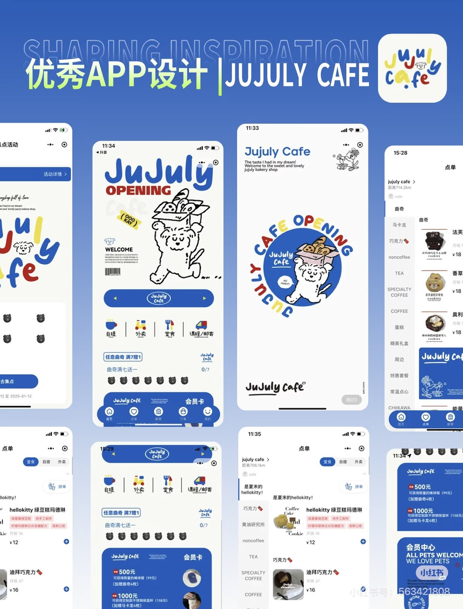
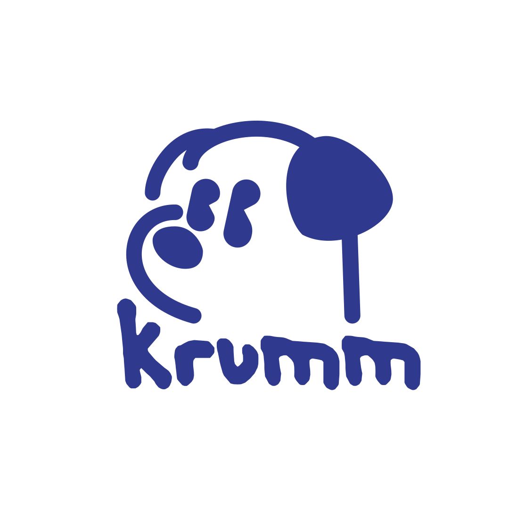

# Krumms UI Design Guide

Read this file before designing or building any Krumms screen. It defines the look, feel, components, and rules for the app on mobile and desktop.

**Asset files.** Paths are relative to this file. All assets live in the `UI-Inspo/` folder next to this guide. Open and look at the images before designing.

| File | Role |
| --- | --- |
| [`UI-Inspo/main-inspo.jpg`](UI-Inspo/main-inspo.jpg) | **Primary reference.** JuJuly Cafe app. When in doubt, copy its spirit. |
| [`UI-Inspo/krumm-logo.svg`](UI-Inspo/krumm-logo.svg) | **Logo, vector.** Dog head + "krumm" wordmark. Use this in code. |
| [`UI-Inspo/krumm-logo.png`](UI-Inspo/krumm-logo.png) | Logo, raster backup (same design). |
| [`UI-Inspo/krumm-dog.png`](UI-Inspo/krumm-dog.png) | The mascot, Krumm the dog (head only, no wordmark). |
| [`UI-Inspo/inspo-playful-cards.jpg`](UI-Inspo/inspo-playful-cards.jpg) | Secondary: playful cards, friendly stats, celebration screens. |
| [`UI-Inspo/inspo-mood-blocks.jpg`](UI-Inspo/inspo-mood-blocks.jpg) | Secondary: soft color blocks, mood faces, simple grids. |
| [`UI-Inspo/inspo-game-ui.jpg`](UI-Inspo/inspo-game-ui.jpg) | Secondary: game-like layouts, pill nav, character moments. |





**Logo file note.** `UI-Inspo/krumm-logo.svg` is fully outlined (no live text), so it renders the same everywhere. Use it for the full logo in code. Every shape uses one class, `.cls-1`, filled `#2f398e`.

--- | --- |
| `main-inspo.jpg` | **Primary reference.** JuJuly Cafe app. When in doubt, copy its spirit. |
| `krumm-logo.png` | The product logo (dog head + "krumm" wordmark). |
| `krumm-dog.png` | The mascot, Krumm the dog (head only, no wordmark). |
| `inspo-playful-cards.jpg` | Secondary: playful cards, friendly stats, celebration screens. |
| `inspo-mood-blocks.jpg` | Secondary: soft color blocks, mood faces, simple grids. |
| `inspo-game-ui.jpg` | Secondary: game-like layouts, pill nav, character moments. |

---

## 1. The vibe in one paragraph

Krumms should feel like a hand-drawn cafe loyalty card that came to life. Think JuJuly Cafe: a clean, bright white page, one confident blue doing almost all the work, chunky doodled lettering, a cartoon dog who shows up at the right moments, and little stamps you collect. It should look like a person drew it with a blue marker, not like a template. Fun first, but still clear and trustworthy, because this app touches money.

**Three words:** doodled, blue, rewarding.

**Gut check for every screen:** would this look at home as a page in a sketchbook that a designer friend made for you? If it looks like a generic fintech dashboard, it's wrong.

---

## 2. What to take from each reference

### `UI-Inspo/main-inspo.jpg` (JuJuly Cafe), take a lot from this
- **One-color ink.** Illustrations, lettering, icons, and outlines are drawn in the brand blue on white. Blue is the "ink," not just an accent.
- **Chunky hand-lettered headlines** with a slight bounce, like "JuJuly OPENING."
- **Big blue pill banner** across the screen with a small logo in the middle and arrows on the sides.
- **Doodle icon row** (4 icons with little labels and thin dividers between them).
- **Stamp card progress:** a row of 7 small character stamps with a "0/7" count. This becomes our paw stamp "close to reward" tracker.
- **Blue membership card** with white text and bold numbers.
- **Circular text badge** wrapping around the mascot ("CAFE OPENING" curving around the dog). Use for loading, success, and empty states.
- **Vertical category rail** on the left of the menu screen with the active item marked by a blue bar.
- **Floating blue bottom nav** shaped like a pill, with white outline icons.
- **Small sticker tags** (slightly rotated yellow label "OOO KAY").
- **Pops of yellow and red**, used sparingly like stickers on a blue drawing.

### Secondary references, take a little
- From `UI-Inspo/inspo-playful-cards.jpg`: friendly stat cards, avatar stacks, a big "Congratulations!" celebration moment with cute blobs, soft rounded list rows.
- From `UI-Inspo/inspo-mood-blocks.jpg`: color-blocked cards with simple faces, very readable numbers, calm grids.
- From `UI-Inspo/inspo-game-ui.jpg`: chunky black-outline character energy, cards that tilt slightly, pill nav with an active chip, points counters in a bubble.

### Do not take
- Gradients of any kind.
- 3D characters or emoji avatars. Our illustration style is flat line drawing.
- Black as a main color. Our "black" is the brand blue.
- Dark mode screens. Krumms is light mode.

---

## 3. Color

Blue is the hero. Everything else is a sticker on top of it.

### Core palette

| Token | Hex | Use |
| --- | --- | --- |
| `--krumm-blue` | `#2F398E` | **Primary.** Ink for text, outlines, illustrations, icons, primary buttons, nav bar, membership card. Sampled from the logo. |
| `--krumm-blue-600` | `#3E49A8` | Hover state on blue surfaces. |
| `--krumm-blue-300` | `#9AA3E0` | Disabled ink, inactive stamps, chart secondary. |
| `--krumm-blue-100` | `#E4E7FA` | Light blue chips, selected rows, soft card fills. |
| `--krumm-blue-50` | `#F2F4FD` | Very light section backgrounds. |
| `--paper` | `#FFFDF8` | **Page background.** Warm off-white, like paper. |
| `--card` | `#FFFFFF` | Cards on the paper. |

### Sticker accents (use small, never as large backgrounds)

| Token | Hex | Use |
| --- | --- | --- |
| `--butter` | `#FFD84D` | Highlights, sticker tags, "close to earning," stars, the free food moment. |
| `--tomato` | `#F05A47` | "Poor use of points," expiring soon, warnings, the heart. |
| `--mint` | `#7FD6A8` | "Best value," success, approved. |
| `--bubblegum` | `#FFB8CC` | Cheeks on the dog, playful tags, celebration confetti. |

### Rules
- Text is `--krumm-blue` by default, never pure black. Secondary text uses `--krumm-blue` at 65% opacity (`rgba(47,57,142,0.65)`).
- On blue surfaces, text and icons are white `#FFFFFF` or `--paper`.
- Accents are for meaning or delight. A screen should be roughly 70% paper/white, 25% blue, 5% accents.
- Never use red or green alone to carry meaning. Always pair with a label or icon ("Best value" with a star, "Poor use" with a frowny face).
- No gradients, no glows, no neon, no drop shadows that look digital. See "Depth" below.

---

## 4. Typography

| Role | Font | Notes |
| --- | --- | --- |
| Display (headlines, big numbers, logo-like moments) | **Gluten** (Google Fonts, weight 700 to 900) | Chunky, rounded, bouncy. Closest free match to the logo and JuJuly lettering. |
| Scribble accents (annotations, sticker text, mascot speech) | **Caveat** (weight 600 to 700) | Handwritten marker feel. Use for short notes only, never paragraphs. |
| UI and body (labels, chat, tables, buttons) | **DM Sans** (weight 400, 500, 700) | Clean and friendly. Turn on `font-variant-numeric: tabular-nums` for prices and points. |

### Scale

| Token | Mobile | Desktop | Font |
| --- | --- | --- | --- |
| `display-xl` | 44px | 64px | Gluten 900 |
| `display-l` | 32px | 44px | Gluten 800 |
| `display-m` | 24px | 30px | Gluten 700 |
| `title` | 18px | 20px | DM Sans 700 |
| `body` | 16px | 16px | DM Sans 400, line-height 1.5 |
| `label` | 13px | 13px | DM Sans 500 |
| `scribble` | 20px | 24px | Caveat 700 |

### Lettering tricks that make it feel hand-made
- Rotate display headlines by -1deg to -2deg.
- Let one word in a headline sit on a butter-yellow highlighter swipe (an SVG blob behind the text, not a rectangle).
- Put a hand-drawn squiggle underline under key numbers ("$7.25", "150 pts").
- Mix sizes inside a headline like JuJuly ("**Free** lunch, *maybe*").

---

## 5. The hand-drawn system

This is what keeps Krumms from looking AI-made. Apply it consistently.

### Borders
- Every card, button, input, and chip has a **2px solid `--krumm-blue` outline**. This is the "marker line."
- Use slightly uneven corners so shapes look drawn, not machine-cut:
  ```css
  .doodle-box { border: 2px solid var(--krumm-blue); border-radius: 22px 18px 24px 16px / 18px 24px 16px 22px; }
  .doodle-pill { border: 2px solid var(--krumm-blue); border-radius: 999px 960px 999px 940px / 940px 999px 960px 999px; }
  ```
- For hero elements only (the big banner, the membership card, empty states), add a real wobble with an SVG filter:
  ```html
  <filter id="wobble"><feTurbulence type="fractalNoise" baseFrequency="0.02" numOctaves="2" seed="3"/><feDisplacementMap in="SourceGraphic" scale="3"/></filter>
  ```
  Keep `scale` at 2 to 4. Don't put the filter on text or on anything in the data grid.

### Depth
- No soft blurry shadows. Use a **flat offset shadow** like a sticker or a printed card: `box-shadow: 4px 4px 0 var(--krumm-blue);`
- Pressed state: move the element 2px down-right and shrink the shadow to `2px 2px 0`.
- Cards that are "special" (reward ready, approval) can tilt by 1deg to 2deg.

### Doodles and decorations
- Draw small blue line doodles in empty space: stars, sparkles, crumbs, little bones, steam lines over cups, paw prints, motion lines.
- At most 2 or 3 doodles per screen. They decorate corners and gaps, never cover content.
- Doodles are inline SVG with `stroke="#2F398E"`, `stroke-width="2.5"`, `stroke-linecap="round"`, `fill="none"`.

### Icons
- Use **Tabler Icons** or **Phosphor (regular weight)** in `--krumm-blue`, stroke 2px, rounded caps. These match the marker line.
- For the 4 main home actions, use custom doodle icons in JuJuly style (blue line with one yellow or red fill spot): **Rewards** (gift box), **Eat** (bowl with steam), **Pay** (wallet), **Deals** (ticket).

### Texture (optional, subtle)
- A very faint paper grain on `--paper` at 3% opacity. If it hurts performance or looks muddy, skip it.

---

## 6. Krumm the mascot

Krumm is the dog from `UI-Inspo/krumm-dog.png` (also the dog shape in `UI-Inspo/krumm-logo.svg`). Krumm is the agent's face. When the AI talks, Krumm is talking.

### Personality
Loyal, a little goofy, always sniffing out a deal. Never sarcastic about the user's money. Celebrates wins loudly, delivers bad news gently.

### Where Krumm appears

| Moment | How |
| --- | --- |
| Chat avatar | Small Krumm head (32px mobile, 40px desktop) in a blue-outlined circle next to every agent message. |
| Thinking / loading | Krumm head inside a **circular text badge** that slowly rotates: "SNIFFING OUT DEALS • SNIFFING OUT DEALS •". Directly borrowed from the JuJuly "CAFE OPENING" circle. |
| Empty states | Larger Krumm with a Caveat speech note: "No rewards yet. Let's go find some!" |
| Reward unlocked | Krumm with butter-yellow sparkles and bubblegum cheeks, plus confetti crumbs. |
| Errors | Krumm with a tilted head and a small question mark doodle. Copy stays kind: "Hmm, I couldn't reach Demo Diner. Want to try again?" |
| Onboarding | Big Krumm on the welcome screen, JuJuly "OPENING" style. |

### Rules
- Use the provided dog artwork as the base. You may add small extras around it (sparkles, a speech bubble, a fork, a crumb, motion lines, cheeks) in the same blue line style.
- Do not redraw Krumm in a different style, add gradients, or make it 3D.
- Never put Krumm next to a money decision in a way that feels pushy. On the approval card, Krumm is small and calm.
- Recolor only to white (on blue surfaces) or `--krumm-blue`. No other colors for the dog itself, except bubblegum cheeks as an added touch.

### Logo use
- The full logo (`UI-Inspo/krumm-logo.svg`, with `UI-Inspo/krumm-logo.png` as a raster backup) goes on the splash screen, the top of the desktop sidebar, and the end card.
- Minimum size: 40px tall on mobile, 48px on desktop. Leave clear space of at least half the logo's height around it.
- On blue backgrounds, use a white version of the logo. With the SVG, set `fill: #FFFFFF` on its `.cls-1` class instead of making a new file.
- To get the dog without the wordmark from the SVG, inline it and drop the five wordmark paths (the letters sit below y = 690), or just use `UI-Inspo/krumm-dog.png`. Recolor by overriding `fill`. Its viewBox is `0 0 1080 1080` with lots of empty space, so crop it with a tighter viewBox (about `250 240 610 470` for the dog alone) when you need the dog to fill an avatar circle.

---

## 7. Layout

### Mobile (base design, 375 to 430px wide)
- Page padding: 20px sides.
- Spacing scale: 4, 8, 12, 16, 20, 24, 32, 40, 56.
- **Floating blue pill nav** at the bottom (from Main Inspo): 16px from the screen edges, 64px tall, `--krumm-blue` fill, white outline icons with tiny labels. Active tab gets a white pill behind the icon with blue icon.
- Tabs: **Home, Rewards, Krumm (chat), Purchases, Me**. The middle Krumm tab is a raised circle with the dog head, slightly bigger than the others.
- Top bar: page title in Gluten on the left, points bubble (like `inspo-game-ui.jpg`) on the right.

### Desktop (1024px and up)
Same personality, more room. It should feel like the mobile app opened up like a notebook, not like a different product.
- **Left sidebar** (240px): logo at top, nav items as doodle pills, the active item filled blue with white text. A small Krumm doodle at the bottom with a Caveat tip ("Psst, 2 rewards expire Friday").
- **Main area** max width 1200px, centered on `--paper`.
- **Rewards page:** two columns. Left: the rewards grid (wide). Right (360px): the membership card and stamp card stacked.
- **Chat page:** chat in the center (max 720px), a right panel shows the current recommendation card and the approval card so the user never loses context.
- The bottom pill nav becomes the sidebar. Never show both.

### Breakpoints
| Name | Width | Layout |
| --- | --- | --- |
| `sm` | < 640px | Single column, bottom pill nav |
| `md` | 640 to 1023px | Two-column cards, bottom pill nav, wider padding (32px) |
| `lg` | 1024px+ | Sidebar, multi-column |

---

## 8. Components

### Buttons
| Variant | Look |
| --- | --- |
| Primary | `--krumm-blue` fill, white DM Sans 700 text, doodle-pill shape, 2px blue border, `4px 4px 0` offset shadow in `#1E2563` (a darker blue). 52px tall on mobile. |
| Secondary | White fill, blue 2px border, blue text, same offset shadow in `--krumm-blue`. |
| Sticker | Butter-yellow fill, blue border and text, rotated -2deg. Used for one fun action per screen at most ("Find me lunch!"). |
| Pay with PayPal | Use the official PayPal JS SDK button as is. Place it inside a doodle-box card, but never restyle or redraw the PayPal button itself. |

### Hero banner (from Main Inspo)
A full-width blue pill with a white mini Krumm logo in the middle and small arrow chevrons at each end. Use on Home as a carousel for "Today's best deal."

### Membership card (from Main Inspo)
- Blue fill, white text, doodle-box shape, slight -1deg tilt, wobble filter.
- Top: program name in Gluten (e.g., "Demo Diner").
- Middle: big point balance ("162 pts") in display-l.
- Bottom: freshness ("updated 2 min ago") in label size, white at 75%.
- A white Krumm doodle peeks in from the corner.

### Stamp card, "close to reward" (from Main Inspo bear stamps)
- A row of **paw-print stamps** (7 or the number of visits needed).
- Earned stamps: filled `--krumm-blue`. Unearned: outlined `--krumm-blue-300`.
- Label above: "Free drink" in Gluten, count on the right "4/7" in DM Sans tabular.
- When the user reaches the reward, the last stamp pops in with a small bounce and the card gets a butter-yellow "Ready!" sticker.
- On desktop and in the grid, the same idea renders as a chunky progress bar with paw marks along it.

### Doodle icon row (from Main Inspo)
Four doodle icons with labels, separated by thin hand-drawn vertical lines. Sits under the hero banner on Home.

### Category rail (from Main Inspo menu screen)
On restaurant and menu screens, a vertical list of categories on the left, active item marked by a 4px blue bar and bold text. On desktop it becomes horizontal pill tabs.

### Chips and tags
- Preference chips (e.g., "No burgers", "Under $8"): light blue fill `--krumm-blue-100`, blue text, small x to remove. A tiny Caveat note can appear the first time: "got it, I'll remember!"
- Value tags: "Best value" (mint fill, star icon), "Poor use" (tomato fill at 20% with tomato text, frowny icon), "Expires Fri" (butter fill, clock icon).
- Sticker tags (decorative): butter fill, rotated, Caveat text.

### Points bubble
White pill, blue border, coin doodle on the right, tabular number. Top right of mobile screens.

### Cards
- White on paper, doodle-box border, 20px padding (24px desktop), offset shadow `4px 4px 0` in `--krumm-blue` at 15% opacity for quiet cards, full blue for hero cards.

### Inputs
- Doodle-pill shape, white fill, 2px blue border, 52px tall.
- Focus: border thickens to 3px and a butter-yellow offset shadow appears.
- Chat input has Krumm's paw as the send button.

---

## 9. Key screens

### Splash / welcome
Big Krumm (Main Inspo "JuJuly OPENING" layout): logo top left, chunky Gluten headline "Stop leaving crumbs on the table," big dog illustration with motion lines, one yellow sticker tag ("free food inside!"), primary button "Let's go."

### Home
1. Greeting in Gluten: "Hey Alex, hungry?" with a scribble arrow.
2. Hero banner carousel: "Today's best deal."
3. Doodle icon row: Rewards, Eat, Pay, Deals.
4. Stamp card for the closest reward.
5. "Krumm found something" card: e.g., "You eat at Basil Bowl weekly but you're not in their rewards," with Krumm small in the corner and a "Join" button.

### Rewards (AG Grid view)
See section 10 for grid styling. Above the grid: membership cards in a horizontal scroll (mobile) or the right column (desktop). Filter chips for programs and preferences.

### Chat with Krumm
- Agent bubbles: white doodle-box with blue border, Krumm avatar on the left.
- User bubbles: `--krumm-blue` fill, white text, right aligned, uneven corners.
- Ranked picks render as an in-chat mini grid (3 rows), the top pick with a butter "Top pick" sticker and an "Approve" button per row.
- Thinking state: the rotating "SNIFFING OUT DEALS" badge, small.

### Approval card (most important screen for trust)
- Calmer than everything else: no tilt, no wobble, no confetti.
- Title: "Ready to order?"
- Rows: item, restaurant, price, and reward impact ("+72 pts, unlocks Free drink").
- Small Krumm in the corner with a Caveat note: "Nothing happens until you say so."
- Buttons: secondary "Not now" and the PayPal button.
- Sandbox label visible during the hackathon: small blue-100 chip "Sandbox".

### Success / reward unlocked
- Big circular text badge around Krumm: "FREE DRINK UNLOCKED •".
- Crumb and sparkle confetti in butter, bubblegum, and blue.
- The stamp card animates to full.
- Buttons: "Back home" and a sticker button "Show me more deals."

### Connect accounts
- List of program cards, each with a status: Connected (mint dot), Needs login (butter dot), Not joined (outline).
- The hosted login opens in a doodle-box frame with a note: "You log in, Krumm never sees your password."

### Purchases
- PayPal purchases list or grid. Each row: restaurant, date, amount, and a "Not enrolled" butter tag with "Join" when relevant.

---

## 10. AG Grid styling

The grid must look like part of the sketchbook, not a spreadsheet pasted in.

- Use the Quartz theme as a base and override with these params:
  ```js
  themeQuartz.withParams({
    fontFamily: 'DM Sans, sans-serif',
    foregroundColor: '#2F398E',
    backgroundColor: '#FFFFFF',
    headerBackgroundColor: '#F2F4FD',
    headerTextColor: '#2F398E',
    headerFontWeight: 700,
    borderColor: '#2F398E',
    rowBorder: { style: 'dashed', width: 1, color: '#9AA3E0' },
    wrapperBorder: { width: 2, color: '#2F398E' },
    wrapperBorderRadius: 20,
    selectedRowBackgroundColor: '#E4E7FA',
    rowHoverColor: '#F2F4FD',
    spacing: 8,
    fontSize: 15,
  });
  ```
- Dashed row lines feel like a ruled notebook.
- Cents-per-point column: tabular numbers, the best value cell gets a mint "Best value" tag, the worst gets a tomato "Poor use" tag.
- "Close to earning" column: custom cell renderer with paw-print progress.
- Group rows by program with a small program logo doodle (fictional brands only).
- Mobile: hide less important columns (expiration, freshness) and let rows be 56px tall for thumbs.
- Do not apply the wobble filter or tilts inside the grid. Numbers must stay crisp.

---

## 11. Motion

Bouncy and quick, like a cartoon.

| Element | Animation |
| --- | --- |
| Buttons | Press: translate 2px down-right, 80ms. Release: spring back. |
| Cards appearing | Fade + rise 8px with a tiny overshoot, 220ms, stagger 40ms. |
| Stamp earned | Scale 0 to 1.2 to 1, 300ms, plus a tiny rotate. |
| Loading badge | Text circle rotates 360deg every 8s. |
| Reward unlocked | Confetti crumbs fall for 1.2s. Krumm's head does a small wiggle. |
| Krumm idle (empty states) | Ear flop: rotate the ear part 4deg back and forth every 3s. Only if the SVG is split into parts. |

Use `cubic-bezier(0.34, 1.56, 0.64, 1)` for bouncy springs. Respect `prefers-reduced-motion`: replace movement with simple fades.

---

## 12. Voice and microcopy

Write like a friend who's good with money, talking to a college student.

| Instead of | Write |
| --- | --- |
| "Reward redemption available" | "You've got a free drink waiting!" |
| "Insufficient points" | "Almost! 30 more points to go." |
| "Error: extraction failed" | "Hmm, I couldn't read your Demo Diner points. Try again?" |
| "Confirm transaction" | "Ready to order?" |
| "Preferences updated" | "Got it. No more burgers." |

- Short sentences. Contractions. One emoji-free joke per screen at most.
- Never shame spending. Never guilt-trip about wasted points.
- Numbers always exact: "$7.25", "150 pts", "expires Fri, Nov 20."

---

## 13. Accessibility

- Body text on white with `--krumm-blue` passes WCAG AA easily (about 10:1). White on blue also passes.
- Butter yellow is never used for text. Text on butter is `--krumm-blue`.
- Tomato and mint tags always include an icon and a word.
- Tap targets at least 44 by 44px.
- Every doodle is `aria-hidden="true"`. Krumm images in states have alt text describing the message, e.g., "Krumm the dog celebrating."
- Focus rings: 3px butter-yellow outline offset by 2px, visible on every interactive element.

---

## 14. Do and don't

**Do**
- Draw with blue. Outline everything.
- Use Krumm to explain what the AI is doing.
- Keep money screens calm and clear, and fun screens loud.
- Leave whitespace. JuJuly works because the page breathes.
- Make the same components work on mobile and desktop.

**Don't**
- Use gradients, glassmorphism, blurry shadows, neon, or dark mode.
- Use real restaurant names or logos anywhere (hackathon rule). Use Demo Diner and Basil Bowl.
- Restyle or redraw the PayPal button.
- Use more than 2 or 3 doodles per screen, or put doodles over numbers.
- Use generic stock illustrations, 3D characters, or emoji as decoration.
- Make every element tilted. Tilt is a spice, one or two things per screen.

---

## 15. Starter CSS tokens

```css
@import url('https://fonts.googleapis.com/css2?family=Gluten:wght@700;800;900&family=Caveat:wght@600;700&family=DM+Sans:wght@400;500;700&display=swap');

:root {
  --krumm-blue: #2F398E;
  --krumm-blue-dark: #1E2563;
  --krumm-blue-600: #3E49A8;
  --krumm-blue-300: #9AA3E0;
  --krumm-blue-100: #E4E7FA;
  --krumm-blue-50: #F2F4FD;
  --paper: #FFFDF8;
  --card: #FFFFFF;
  --butter: #FFD84D;
  --tomato: #F05A47;
  --mint: #7FD6A8;
  --bubblegum: #FFB8CC;

  --ink: var(--krumm-blue);
  --ink-muted: rgba(47, 57, 142, 0.65);

  --font-display: 'Gluten', cursive;
  --font-scribble: 'Caveat', cursive;
  --font-ui: 'DM Sans', system-ui, sans-serif;

  --line: 2px solid var(--krumm-blue);
  --shadow-pop: 4px 4px 0 var(--krumm-blue);
  --shadow-quiet: 4px 4px 0 rgba(47, 57, 142, 0.15);
  --radius-doodle: 22px 18px 24px 16px / 18px 24px 16px 22px;
  --radius-pill: 999px 960px 999px 940px / 940px 999px 960px 999px;
  --spring: cubic-bezier(0.34, 1.56, 0.64, 1);
}

body { background: var(--paper); color: var(--ink); font-family: var(--font-ui); }
h1, h2, .display { font-family: var(--font-display); color: var(--ink); letter-spacing: -0.01em; }
.card { background: var(--card); border: var(--line); border-radius: var(--radius-doodle); box-shadow: var(--shadow-quiet); padding: 20px; }
.btn-primary { background: var(--krumm-blue); color: #fff; border: var(--line); border-radius: var(--radius-pill); box-shadow: 4px 4px 0 var(--krumm-blue-dark); height: 52px; padding: 0 24px; font-weight: 700; transition: transform 80ms var(--spring), box-shadow 80ms; }
.btn-primary:active { transform: translate(2px, 2px); box-shadow: 2px 2px 0 var(--krumm-blue-dark); }
:focus-visible { outline: 3px solid var(--butter); outline-offset: 2px; }
```

---

## 16. Final check before shipping a screen

- [ ] Mostly paper and white, blue ink, accents only as stickers
- [ ] Every card and button has the 2px blue marker line and an offset shadow, no blur
- [ ] At least one hand-made touch (tilt, scribble, doodle, wobble, or Krumm), but not all of them at once
- [ ] Money moments (approval, checkout) are calm and clear
- [ ] Works at 375px and at 1280px
- [ ] No real brands, no restyled PayPal button
- [ ] Copy sounds like a friend, numbers are exact
